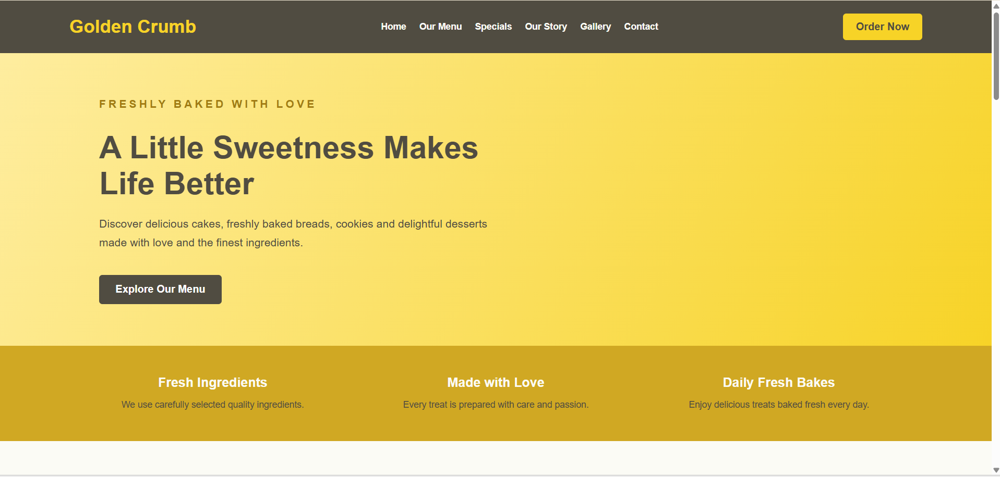
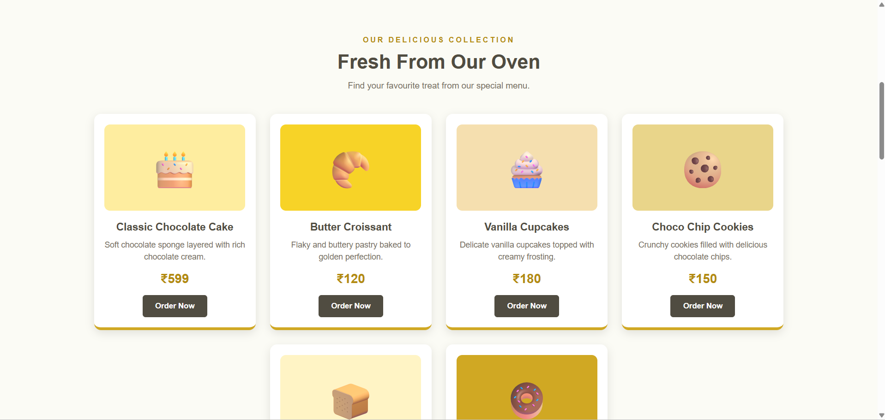
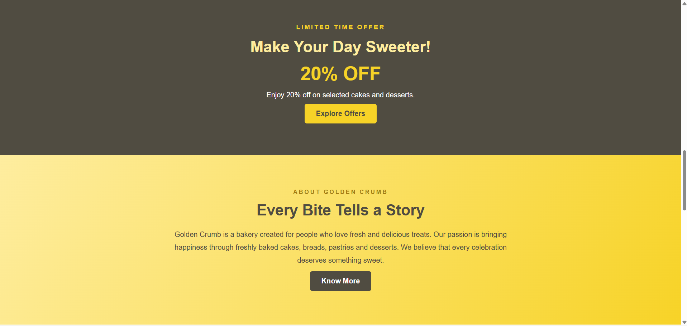
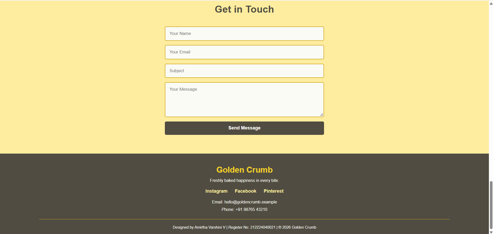

# Ex02 Commercial Website
## Date: 02.11.2026

## AIM
To create a commercial website using CSS Flexbox.

## ALGORITHM
### STEP 1
Create an HTML file (index.html)

### STEP 2
Create a CSS file (style.css)

### STEP 3
Include a navigation bar with links to different sections.

### STEP 4
Add structured sections for Homepage, Products / Services, About Us, Contact Details and User Account.

### STEP 5
Include social media links at the footer with copyright information.

### STEP 6
Define global styles for fonts, colors, and layout.

### STEP 7
Style the header, navigation bar, and sections.

### STEP 8
Use Flexbox for layout design.

### STEP 9
Add hover effects and transitions for interactivity.

### STEP 10
Add Images and Media.

### STEP 11
Use optimized images for a professional look.

### STEP 12
Open the HTML file in a browser to check layout and functionality.

### STEP 13
Fix styling issues and refine content placement.

### STEP 14
Deploy the website.

### STEP 15
Upload to GitHub Pages for free hosting.

## PROGRAM
index.html:
```

<!DOCTYPE html>
<html lang="en">
<head>
    <meta charset="UTF-8">
    <meta name="viewport" content="width=device-width, initial-scale=1.0">
    <title>Golden Crumb - Bakery & Desserts</title>
    <link rel="stylesheet" href="style.css">
</head>
<body>

    <!-- Header -->
    <header>
        <div class="logo">Golden Crumb</div>

        <nav>
            <a href="#home">Home</a>
            <a href="#menu">Our Menu</a>
            <a href="#specials">Specials</a>
            <a href="#story">Our Story</a>
            <a href="#gallery">Gallery</a>
            <a href="#contact">Contact</a>
        </nav>

        <a href="#menu" class="header-btn">Order Now</a>
    </header>

    <!-- Home Section -->
    <section class="hero" id="home">
        <div class="hero-content">
            <p class="welcome">FRESHLY BAKED WITH LOVE</p>

            <h1>A Little Sweetness Makes Life Better</h1>

            <p>
                Discover delicious cakes, freshly baked breads,
                cookies and delightful desserts made with love
                and the finest ingredients.
            </p>

            <a href="#menu" class="main-btn">Explore Our Menu</a>
        </div>
    </section>

    <!-- Features Section -->
    <section class="features">
        <div class="feature">
            <h3>Fresh Ingredients</h3>
            <p>We use carefully selected quality ingredients.</p>
        </div>

        <div class="feature">
            <h3>Made with Love</h3>
            <p>Every treat is prepared with care and passion.</p>
        </div>

        <div class="feature">
            <h3>Daily Fresh Bakes</h3>
            <p>Enjoy delicious treats baked fresh every day.</p>
        </div>
    </section>

    <!-- Menu Section -->
    <section class="menu" id="menu">
        <div class="section-heading">
            <p>OUR DELICIOUS COLLECTION</p>
            <h2>Fresh From Our Oven</h2>
            <span>Find your favourite treat from our special menu.</span>
        </div>

        <div class="products">

            <div class="product-card">
                <div class="product-image cake">🎂</div>
                <h3>Classic Chocolate Cake</h3>
                <p>Soft chocolate sponge layered with rich chocolate cream.</p>
                <h4>₹599</h4>
                <button>Order Now</button>
            </div>

            <div class="product-card">
                <div class="product-image croissant">🥐</div>
                <h3>Butter Croissant</h3>
                <p>Flaky and buttery pastry baked to golden perfection.</p>
                <h4>₹120</h4>
                <button>Order Now</button>
            </div>

            <div class="product-card">
                <div class="product-image cupcake">🧁</div>
                <h3>Vanilla Cupcakes</h3>
                <p>Delicate vanilla cupcakes topped with creamy frosting.</p>
                <h4>₹180</h4>
                <button>Order Now</button>
            </div>

            <div class="product-card">
                <div class="product-image cookies">🍪</div>
                <h3>Choco Chip Cookies</h3>
                <p>Crunchy cookies filled with delicious chocolate chips.</p>
                <h4>₹150</h4>
                <button>Order Now</button>
            </div>

            <div class="product-card">
                <div class="product-image bread">🍞</div>
                <h3>Farmhouse Milk Bread</h3>
                <p>Fresh, soft and fluffy bread perfect for breakfast.</p>
                <h4>₹90</h4>
                <button>Order Now</button>
            </div>

            <div class="product-card">
                <div class="product-image donut">🍩</div>
                <h3>Glazed Donuts</h3>
                <p>Delightful soft donuts coated with a sweet glaze.</p>
                <h4>₹100</h4>
                <button>Order Now</button>
            </div>

        </div>
    </section>

    <!-- Specials Section -->
    <section class="specials" id="specials">
        <div class="special-content">
            <p>LIMITED TIME OFFER</p>
            <h2>Make Your Day Sweeter!</h2>
            <h3>20% OFF</h3>
            <p>Enjoy 20% off on selected cakes and desserts.</p>
            <a href="#menu" class="main-btn">Explore Offers</a>
        </div>
    </section>

    <!-- Our Story Section -->
    <section class="story" id="story">
        <div class="story-content">
            <p>ABOUT GOLDEN CRUMB</p>
            <h2>Every Bite Tells a Story</h2>

            <p>
                Golden Crumb is a bakery created for people who
                love fresh and delicious treats. Our passion is
                bringing happiness through freshly baked cakes,
                breads, pastries and desserts. We believe that
                every celebration deserves something sweet.
            </p>

            <a href="#contact" class="main-btn">Know More</a>
        </div>
    </section>

    <!-- Gallery Section -->
    <section class="gallery" id="gallery">
        <div class="section-heading">
            <p>A FEAST FOR YOUR EYES</p>
            <h2>Our Sweet Moments</h2>
        </div>

        <div class="gallery-items">
            <div class="gallery-box gallery-one">🍰</div>
            <div class="gallery-box gallery-two">🍩</div>
            <div class="gallery-box gallery-three">🥧</div>
            <div class="gallery-box gallery-four">🍪</div>
        </div>
    </section>

    <!-- Contact Section -->
    <section class="contact" id="contact">
        <div class="section-heading">
            <p>WE WOULD LOVE TO HEAR FROM YOU</p>
            <h2>Get in Touch</h2>
        </div>

        <form>
            <input type="text" placeholder="Your Name" required>
            <input type="email" placeholder="Your Email" required>
            <input type="text" placeholder="Subject" required>
            <textarea rows="5" placeholder="Your Message" required></textarea>
            <button type="submit">Send Message</button>
        </form>
    </section>

    <!-- Footer -->
    <footer>
        <div class="footer-content">
            <h2>Golden Crumb</h2>

            <p>Freshly baked happiness in every bite.</p>

            <div class="social-links">
                <a href="#">Instagram</a>
                <a href="#">Facebook</a>
                <a href="#">Pinterest</a>
            </div>

            <p>Email: hello@goldencrumb.example</p>
            <p>Phone: +91 98765 43210</p>
        </div>

        <div class="footer-bottom">
            <p>
                Designed by Amirtha Varshini V |
                Register No: 212224040021 |
                &copy; 2026 Golden Crumb
            </p>
        </div>
    </footer>

</body>
</html>

```

style.css:
```

/* GENERAL STYLING */
* {
    margin: 0;
    padding: 0;
    box-sizing: border-box;
    font-family: Arial, sans-serif;
    scroll-behavior: smooth;
}

body {
    background-color: #FBFBF5;
    color: #504C41;
}

/* HEADER */
header {
    display: flex;
    justify-content: space-between;
    align-items: center;
    padding: 20px 7%;
    background-color: #504C41;
    color: white;
}

.logo {
    font-size: 28px;
    font-weight: bold;
    color: #F7D327;
}

nav {
    display: flex;
    gap: 20px;
}

nav a {
    color: #FBFBF5;
    text-decoration: none;
    font-size: 14px;
    font-weight: bold;
}

nav a:hover {
    color: #F7D327;
}

.header-btn {
    background-color: #F7D327;
    color: #504C41;
    padding: 11px 20px;
    border-radius: 5px;
    text-decoration: none;
    font-weight: bold;
}

.header-btn:hover {
    background-color: #FEED9F;
}

/* HERO SECTION */
.hero {
    min-height: 450px;
    display: flex;
    align-items: center;
    padding: 60px 10%;
    background: linear-gradient(
        120deg,
        #FEED9F,
        #F7D327
    );
    color: #504C41;
}

.hero-content {
    max-width: 620px;
}

.welcome {
    font-size: 14px;
    letter-spacing: 4px;
    font-weight: bold;
    margin-bottom: 20px;
    color: #A17B13;
}

.hero h1 {
    font-size: 48px;
    margin-bottom: 20px;
    color: #504C41;
}

.hero p {
    font-size: 17px;
    line-height: 1.7;
    margin-bottom: 25px;
}

.main-btn {
    display: inline-block;
    background-color: #504C41;
    color: white;
    padding: 13px 25px;
    text-decoration: none;
    border-radius: 5px;
    margin-top: 10px;
    font-weight: bold;
}

.main-btn:hover {
    background-color: #D0A823;
    color: #504C41;
}

/* FEATURES SECTION */
.features {
    display: flex;
    justify-content: space-around;
    gap: 25px;
    padding: 45px 8%;
    background-color: #D0A823;
    text-align: center;
}

.feature {
    flex: 1;
}

.feature h3 {
    color: #FBFBF5;
    margin-bottom: 12px;
    font-size: 20px;
}

.feature p {
    color: #504C41;
    line-height: 1.5;
    font-size: 14px;
}

/* MENU SECTION */
.menu {
    padding: 65px 8%;
    text-align: center;
    background-color: #FBFBF5;
}

.section-heading {
    text-align: center;
    margin-bottom: 40px;
}

.section-heading p {
    color: #B38B12;
    font-size: 13px;
    font-weight: bold;
    letter-spacing: 3px;
    margin-bottom: 12px;
}

.section-heading h2 {
    font-size: 34px;
    color: #504C41;
    margin-bottom: 12px;
}

.section-heading span {
    color: #777064;
    font-size: 15px;
}

/* PRODUCT CARDS */
.products {
    display: flex;
    flex-wrap: wrap;
    justify-content: center;
    gap: 25px;
}

.product-card {
    width: 280px;
    background-color: white;
    padding: 18px;
    border-radius: 12px;
    box-shadow: 0 5px 15px rgba(80, 76, 65, 0.15);
    text-align: center;
    transition: transform 0.3s;
    border-bottom: 5px solid #D0A823;
}

.product-card:hover {
    transform: translateY(-8px);
}

.product-image {
    height: 150px;
    display: flex;
    justify-content: center;
    align-items: center;
    font-size: 65px;
    border-radius: 10px;
    margin-bottom: 18px;
}

.cake {
    background-color: #FEED9F;
}

.croissant {
    background-color: #F7D327;
}

.cupcake {
    background-color: #F5DFAF;
}

.cookies {
    background-color: #E9D58A;
}

.bread {
    background-color: #FFF4C5;
}

.donut {
    background-color: #D0A823;
}

.product-card h3 {
    font-size: 18px;
    margin-bottom: 10px;
    color: #504C41;
}

.product-card p {
    color: #777064;
    font-size: 14px;
    line-height: 1.5;
    min-height: 42px;
}

.product-card h4 {
    color: #B38B12;
    font-size: 22px;
    margin: 15px 0;
}

.product-card button {
    background-color: #504C41;
    color: white;
    border: none;
    padding: 11px 22px;
    border-radius: 5px;
    cursor: pointer;
    font-weight: bold;
}

.product-card button:hover {
    background-color: #D0A823;
    color: #504C41;
}

/* SPECIALS SECTION */
.specials {
    padding: 70px 10%;
    text-align: center;
    background-color: #504C41;
    color: white;
}

.special-content > p:first-child {
    color: #F7D327;
    font-size: 14px;
    letter-spacing: 3px;
    font-weight: bold;
    margin-bottom: 15px;
}

.specials h2 {
    font-size: 35px;
    color: #FEED9F;
    margin-bottom: 15px;
}

.specials h3 {
    font-size: 42px;
    color: #F7D327;
    margin-bottom: 15px;
}

.specials .main-btn {
    background-color: #F7D327;
    color: #504C41;
}

.specials .main-btn:hover {
    background-color: #FEED9F;
}

/* STORY SECTION */
.story {
    padding: 75px 10%;
    background: linear-gradient(
        120deg,
        #FEED9F,
        #F7D327
    );
    text-align: center;
}

.story-content {
    max-width: 750px;
    margin: auto;
}

.story-content > p:first-child {
    color: #A17B13;
    font-size: 13px;
    font-weight: bold;
    letter-spacing: 3px;
    margin-bottom: 15px;
}

.story h2 {
    font-size: 34px;
    margin-bottom: 20px;
    color: #504C41;
}

.story-content > p:nth-of-type(2) {
    font-size: 16px;
    line-height: 1.8;
    color: #504C41;
}

/* GALLERY SECTION */
.gallery {
    padding: 65px 8%;
    background-color: #FBFBF5;
}

.gallery-items {
    display: flex;
    flex-wrap: wrap;
    justify-content: center;
    gap: 20px;
}

.gallery-box {
    flex: 1 1 200px;
    min-height: 180px;
    display: flex;
    justify-content: center;
    align-items: center;
    font-size: 75px;
    border-radius: 12px;
    transition: transform 0.3s;
}

.gallery-box:hover {
    transform: scale(1.04);
}

.gallery-one {
    background-color: #FEED9F;
}

.gallery-two {
    background-color: #F7D327;
}

.gallery-three {
    background-color: #D0A823;
}

.gallery-four {
    background-color: #FFF0BD;
}

/* CONTACT SECTION */
.contact {
    padding: 65px 10%;
    text-align: center;
    background-color: #FEED9F;
}

.contact form {
    max-width: 550px;
    margin: auto;
    display: flex;
    flex-direction: column;
    gap: 15px;
}

.contact input,
.contact textarea {
    width: 100%;
    padding: 14px;
    border: 2px solid #D0A823;
    border-radius: 5px;
    outline: none;
    font-size: 15px;
    background-color: #FBFBF5;
}

.contact input:focus,
.contact textarea:focus {
    border-color: #504C41;
}

.contact button {
    background-color: #504C41;
    color: white;
    border: none;
    padding: 14px;
    border-radius: 5px;
    font-size: 16px;
    font-weight: bold;
    cursor: pointer;
}

.contact button:hover {
    background-color: #D0A823;
    color: #504C41;
}

/* FOOTER */
footer {
    background-color: #504C41;
    color: white;
    text-align: center;
    padding: 40px 8% 20px;
}

.footer-content h2 {
    color: #F7D327;
    margin-bottom: 12px;
    font-size: 28px;
}

.footer-content p {
    margin: 10px 0;
    font-size: 14px;
    color: #FBFBF5;
}

.social-links {
    display: flex;
    justify-content: center;
    gap: 25px;
    margin: 20px 0;
}

.social-links a {
    color: #FEED9F;
    text-decoration: none;
    font-weight: bold;
}

.social-links a:hover {
    color: #F7D327;
}

.footer-bottom {
    border-top: 1px solid #D0A823;
    margin-top: 25px;
    padding-top: 20px;
    font-size: 13px;
}

/* RESPONSIVE DESIGN */
@media (max-width: 900px) {
    header {
        flex-wrap: wrap;
        gap: 20px;
    }

    nav {
        flex-wrap: wrap;
        justify-content: center;
    }

    .hero h1 {
        font-size: 38px;
    }
}

@media (max-width: 600px) {
    header {
        flex-direction: column;
    }

    nav {
        flex-direction: column;
        align-items: center;
        gap: 15px;
    }

    .hero {
        padding: 50px 7%;
    }

    .hero h1 {
        font-size: 32px;
    }

    .features {
        flex-direction: column;
    }

    .product-card {
        width: 100%;
    }

    .menu {
        padding: 45px 6%;
    }

    .gallery-box {
        flex-basis: 100%;
    }
}

```


## OUTPUT










## RESULT
The program for creating commercial website using CSS Flexbox is executed successfully.
